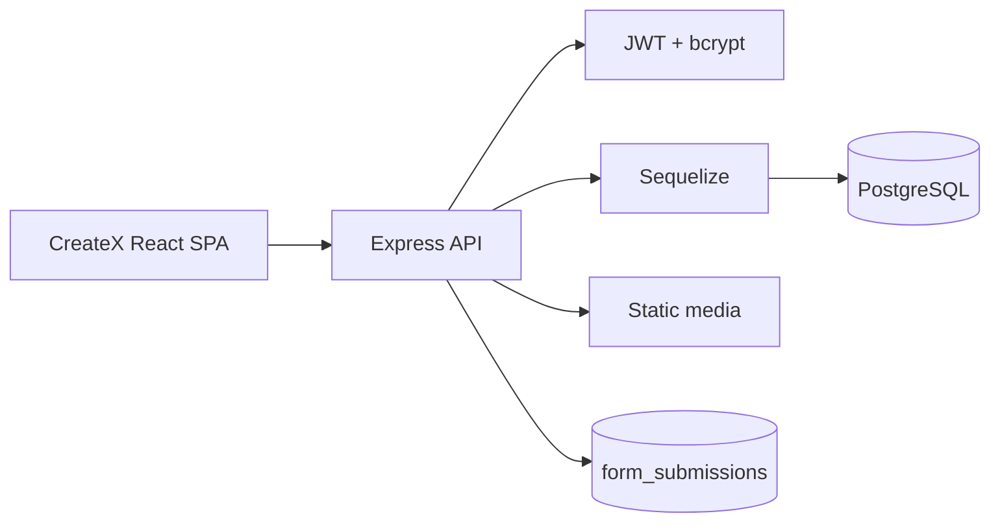

# CreateX API

[](https://github.com/Kotyarya/CreateX-API/actions/workflows/ci.yml)

Express and PostgreSQL API for the [CreateX frontend](https://github.com/Kotyarya/CreateX). It serves courses, events, curators, blog content and media; supports account registration/login; and stores contact, registration and newsletter requests in PostgreSQL.

**Live frontend:** [createx-maksym-aksamitnyi.vercel.app](https://createx-maksym-aksamitnyi.vercel.app)

**Production API:** [createx-api-maksym.onrender.com/api/health](https://createx-api-maksym.onrender.com/api/health)

## Stack

- Node.js 24 and Express
- PostgreSQL with Sequelize
- JWT authentication and bcrypt password hashing
- PostgreSQL-backed form submissions
- Node test runner and Supertest

## Local setup

```bash
git clone https://github.com/Kotyarya/CreateX-API.git
cd CreateX-API
cp .env.example .env
npm ci
npm run db:seed
npm run dev
```

The API starts at [http://localhost:8000/api](http://localhost:8000/api). Readiness is available at `/api/health`.

## Environment

| Variable | Purpose |
| --- | --- |
| `DATABASE_URL` | Preferred PostgreSQL connection string |
| `DB_NAME`, `DB_USER`, `DB_PASSWORD`, `DB_HOST`, `DB_PORT` | Local alternative to `DATABASE_URL` |
| `RANDOM_KEY` | JWT signing secret, minimum 32 characters |
| `CORS_ORIGINS` | Comma-separated frontend origins |

Production startup fails closed when required configuration is missing.

## Security model

- Public endpoints are read-only, except account and contact/newsletter flows.
- Content mutations require an authenticated JWT with the `ADMIN` role.
- CORS uses an explicit allowlist.
- JSON bodies are limited to 100 KiB and uploads to 5 MiB.
- Global and form-specific rate limits reduce abuse.
- Auth failures do not expose JWT parsing details.
- Form input is validated, trimmed and length-limited before persistence.

## Commands

```bash
npm run lint
npm test
npm audit --omit=dev
npm run db:seed
```

The seed script is idempotent. GitHub Actions runs syntax checks, security tests and the production dependency audit without production credentials.

## Architecture



Never commit `.env`. Copy `.env.example` and keep all real credentials in the deployment provider's secret store.
